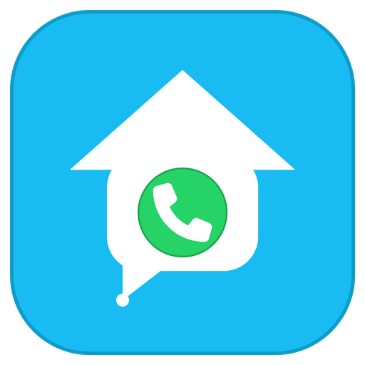

<p align="center">
  
</p>

> [!CAUTION]
> Very, very alpha ... created largely for my own purposes and completely vibe coded. In no way is this
> integration extensively tested or guaranteed to work.

# WhatsApp Web for Home Assistant

Pair your personal WhatsApp account with Home Assistant as a **linked device** —
the same multi-device protocol used by WhatsApp Web and WhatsApp Desktop — and
use incoming messages in automations.

- **Pair from the Home Assistant UI** with a QR code or an 8-character phone
  pairing code. No Business API, no cloud service, no phone-number verification
  code.
- **Messages as events**: a `whatsapp_web_message` bus event and an `event`
  entity for the automation trigger editor.
- **Unread counter**: a `sensor` with the total unread count and a per-chat
  breakdown, reset when a chat is read on any linked device (read receipts and
  app-state sync, including LID/PN aliases).
- **Human names**: sender, chat and group names from push names, contacts and
  group metadata; falls back to `unknown`, never a phone number.
- **Messages card**: a bundled dashboard card showing recent received messages
  only — your replies are excluded.
- **Services** to send a text, mark a chat read, and send a typing indicator.
- **Persistent session**: pair once, keep the session across restarts.

> [!WARNING]
> This uses WhatsApp's unofficial multi-device protocol through
> [Baileys](https://github.com/WhiskeySockets/Baileys). WhatsApp does not
> officially support third-party clients and may restrict or ban an account
> that uses one. Use a dedicated account if that risk matters to you.

---

## How it works

Home Assistant 2026.11 runs on Alpine/musl, and the Python WhatsApp libraries
ship glibc-only Go binaries — they cannot be installed into HA Core. This
project therefore uses the same split as other production WhatsApp
integrations:

```
┌──────────────────────────┐         HTTP + WebSocket         ┌──────────────────────┐
│  Home Assistant          │  ─────────────────────────────►  │  WhatsApp bridge     │
│  custom_components/      │   local network, bearer token    │  Node.js + Baileys   │
│  whatsapp_web            │  ◄─────────────────────────────  │  (Docker / add-on)   │
└──────────────────────────┘         events, unread          └──────────┬───────────┘
                                                                        │
                                                              multi-device protocol
                                                                        │
                                                                ┌───────▼────────┐
                                                                │ WhatsApp phone │
                                                                └────────────────┘
```

The **bridge** owns the WhatsApp socket, the encrypted session, pairing and the
unread state. The **integration** is a normal Home Assistant integration: it
creates entities, fires events, exposes services, and never talks to WhatsApp
directly.

Only the bridge needs to reach the internet. The integration only needs to
reach the bridge on your LAN.

---

## Requirements

- Home Assistant **2026.1** or newer (tested against 2026.10 and 2026.11).
- One of:
  - Home Assistant OS/Supervised, for the add-on, or
  - Docker, for the standalone bridge container, or
  - Node.js 20+ to run the bridge from source.
- A phone with WhatsApp installed for the initial pairing.

---

## 1. Run the bridge

### Option A — Home Assistant add-on (HAOS / Supervised)

1. Copy the `whatsapp_bridge` folder to your Home Assistant `/addons` share, or
   add this repository under **Settings → Add-ons → Add-on Store → ⋮ →
   Repositories**.
2. Install **WhatsApp Web Bridge** and open its **Configuration** tab.
3. Either set `api_token` to a long random string (`openssl rand -hex 32`), or
   leave it empty. If empty, the add-on generates a token on first start and
   prints it in the log.
4. Start the add-on and copy the token from the log if you did not set one.
5. Find the add-on **Hostname** on its Info page (for example
   `local-whatsapp-web-bridge`) and note the port, `3000`.
6. The bridge URL for the integration is `http://<hostname>:3000`
   (for example `http://local-whatsapp-web-bridge:3000`).
   `http://homeassistant.local:3000` also works because the port is mapped to
   the host.

### Option B — Docker Compose

```bash
cp .env.example .env
# put a long random token in .env
docker compose up -d --build
```

The bridge listens on `http://<docker-host>:3000`. The session and unread state
live in the `whatsapp_data` volume.

### Option C — From source

```bash
cd whatsapp_bridge
npm ci
BRIDGE_TOKEN="$(openssl rand -hex 32)" \
BRIDGE_DATA_DIR="$PWD/data" \
npm start
```

| Variable | Default | Purpose |
| --- | --- | --- |
| `BRIDGE_TOKEN` | — | Required API token (16+ chars) |
| `BRIDGE_PORT` | `3000` | HTTP/WebSocket port |
| `BRIDGE_HOST` | `0.0.0.0` | Listen address |
| `BRIDGE_DATA_DIR` | `./data` | Session database, state and QR cache |
| `BRIDGE_LOG_LEVEL` | `info` | `trace`, `debug`, `info`, `warn`, `error` |
| `BRIDGE_AUTO_CONNECT` | `1` | Reconnect a stored session at boot |
| `BRIDGE_MAX_CHATS` | `500` | Cap on remembered chats |

---

## 2. Install the integration

### HACS / Marketplace

1. Add `https://github.com/chrisclayson/whatsapp-web-ha` as a custom repository of
   type **Integration** (or find it in the Marketplace if listed).
2. Install **WhatsApp Web** and restart Home Assistant.

### Manual

Copy `custom_components/whatsapp_web` to
`/config/custom_components/whatsapp_web` and restart Home Assistant.

---

## 3. Pair

1. Go to **Settings → Devices & services → Add integration → WhatsApp Web**.
2. Enter the bridge URL and API token.
3. Choose **Scan a QR code**:
   - Open WhatsApp on your phone → **Settings → Linked devices → Link a
     device** → scan the QR code shown in Home Assistant.
   - Press **Submit** after scanning. If the code expired while the dialog was
     open, a fresh one is shown.
   Or choose **Link with a phone number**:
   - Enter the number in international format (`+15551234567`).
   - Open **WhatsApp → Settings → Linked devices → Link a device → Link with
     phone number instead** and enter the 8-character code.
4. The integration creates a device and its entities as soon as the session is
   connected.

You can also choose **Finish setup and pair later**, then use the integration's
**Configure** button → **Pair or re-pair** when you are ready.

---

## Entities

| Entity | Example | Description |
| --- | --- | --- |
| `sensor.<account>_unread_messages` | `sensor.alice_unread_messages` | Total unread count. Attributes: `chats`, `connected`, `account`, `last_message`, `last_message_at`, `last_message_chat` |
| `sensor.<account>_last_message` | `sensor.alice_last_message` | Text of the most recent message, with chat and sender attributes |
| `sensor.<account>_received_messages` | `sensor.alice_received_messages` | Last 20 **received** messages (incoming only) for the dashboard card. Attributes: `messages`, `count` |
| `binary_sensor.<account>_connection` | `binary_sensor.alice_connection` | `on` while the bridge is connected to WhatsApp |
| `event.<account>_message` | `event.alice_message` | Fires `message_received` / `message_sent` for the trigger editor |

The unread sensor's `chats` attribute is a list of the busiest unread chats:

```yaml
chats:
  - id: 120363000000000000@g.us
    name: Family
    is_group: true
    unread: 4
    last_message_at: "2026-11-20T12:34:56+00:00"
  - id: 15551234567@s.whatsapp.net
    name: Alice
    is_group: false
    unread: 2
    last_message_at: "2026-11-20T12:30:00+00:00"
```

---

## The `whatsapp_web_message` event

Every **live** message seen by the linked device fires a bus event:

```yaml
event_type: whatsapp_web_message
event_data:
  entry_id: 01J...
  instance_id: 3f2c...
  message_id: 3EB0C767D097
  chat_id: 15551234567@s.whatsapp.net
  chat_id_alt: null
  chat_name: Alice
  group_name: null
  is_group: false
  sender_id: 15551234567@s.whatsapp.net
  sender_name: Alice
  sender_username: alice.w
  from_me: false
  type: text            # text, image, video, audio, voice, document,
                        # sticker, location, contact, poll, reaction, ...
  text: "Are you home?"
  timestamp: "2026-11-20T12:34:56+00:00"
  timestamp_epoch: 1795000496
  has_media: false
  media: null           # {mimetype, file_length, seconds, file_name, ...}
  location: null        # {latitude, longitude, name, address, is_live}
  mentions: []
  quoted_message_id: null
  is_forwarded: false
  unread_total: 3
```

Outgoing messages from your phone are emitted only when **Fire events for
messages sent from the phone** is enabled in the integration options. Messages
you send through Home Assistant are also covered by that option.

History messages and messages received while the bridge was offline are **not**
replayed as events.

`chat_name`, `group_name` and `sender_name` are resolved from your contacts,
the WhatsApp profile push name, and group metadata. If a name or username is
not available, the field is the literal string `unknown` — phone numbers are
never used as display names. `group_name` is only set for groups, and
`chat_id_alt` carries the alternate LID/PN identifier when WhatsApp uses both
for the same conversation.

### Trigger from the event entity

The `event` entity works in the UI trigger editor and carries the same fields as
attributes. This is equivalent to the bus trigger and survives entity renames:

```yaml
trigger:
  - platform: state
    entity_id: event.alice_message
    attribute: event_type
    to: message_received
condition:
  - condition: template
    value_template: "{{ trigger.to_state.attributes.text | length > 0 }}"
action:
  - service: notify.mobile_app_phone
    data:
      title: "{{ trigger.to_state.attributes.chat_name }}"
      message: "{{ trigger.to_state.attributes.text }}"
```

A full set of examples is in [docs/automations.md](docs/automations.md).

---

## Unread count semantics

- On connect, WhatsApp's history sync is merged in: a higher badge on the phone
  raises the count, so messages that arrived while the bridge was offline are
  usually included. It never lowers a count that was already tracked live.
- New incoming messages increment the count once per message ID.
- Reading a chat on **any** linked device resets that chat to zero through
  WhatsApp read receipts plus app-state sync. LID and phone-number JIDs for the
  same conversation are aliased, so a read under either identifier clears the
  same chat. The same happens when you call `whatsapp_web.mark_read`.
- Outgoing messages, reactions, protocol messages, status updates and
  newsletters are not counted.
- Events are only emitted for live messages. Messages that arrived while the
  bridge was stopped may appear in the unread count after the next history
  sync, but they are not replayed as events. The count itself is persisted
  across Home Assistant and bridge restarts.

This is deliberately a *per-linked-device* count, matching how WhatsApp Web
shows unread state. It is not a full server-side mailbox mirror.

---

## Messages card

The integration ships a dashboard card that lists **received** messages only.
Replies you send from the phone or through Home Assistant are filtered out.

```yaml
type: custom:whatsapp-messages-card
entity: sensor.alice_received_messages
title: WhatsApp
max_messages: 20
show_group: true
show_time: true
show_avatar: true
```

- `entity` is required; use the **Received messages** sensor for the account.
- `max_messages` defaults to 20.
- `show_group` prefixes group messages with the group name and sender.
- `show_time` shows a time for today and a date for older messages.
- `show_avatar` shows initials in a green circle for groups and a blue circle
  for direct messages.

The card is registered automatically as a frontend module when Home Assistant
starts. If it does not appear in the card picker, add
`/whatsapp_web/whatsapp-messages-card.js` under **Settings → Dashboards →
Resources** as a **JavaScript module**. The sensor stores the buffer in Home
Assistant storage, so the card survives restarts.

---

## Services

### `whatsapp_web.send_message`

```yaml
action: whatsapp_web.send_message
data:
  to: "+15551234567"          # or a JID, or a group JID
  message: "The garage door is open."
response_variable: sent
```

The response contains `message_id`, `chat_id` and `timestamp`. `to` can be:

- a phone number in international format (`+15551234567`),
- a contact JID (`15551234567@s.whatsapp.net`),
- a group JID (`120363000000000000@g.us`).

### `whatsapp_web.mark_read`

```yaml
action: whatsapp_web.mark_read
data:
  chat: "15551234567@s.whatsapp.net"
```

Optional `message_ids` marks specific messages. Without it, the bridge marks
the messages it tracked for that chat as read.

### `whatsapp_web.send_typing`

```yaml
action: whatsapp_web.send_typing
data:
  chat: "15551234567@s.whatsapp.net"
  state: composing           # or paused
```

All three services accept an optional `entry_id` when more than one WhatsApp
account is configured.

---

## Multiple accounts

Add the integration once per bridge account. Each entry gets its own device,
entities and event stream. Services then require `entry_id` (the field is a
dropdown in the UI). One bridge process serves one WhatsApp account; run one
bridge per account.

---

## Troubleshooting

| Symptom | Fix |
| --- | --- |
| `invalid_auth` during setup | Copy the token exactly. For the add-on, set `api_token` or read the generated token from the log. |
| `cannot_connect` | Use the add-on hostname or the Docker host's IP, not `localhost` — `localhost` inside HA is HA itself. |
| QR code is rejected immediately | The add-on clock must be correct; refresh by pressing **Submit** to get a new code. |
| `logged_out` state | The device was unlinked on the phone. Open **Configure → Pair or re-pair**. |
| Connection replaced | Another WhatsApp Web/Desktop session took over. Close it, or re-pair. |
| No events but the sensor updates | Check the integration option for outgoing events and the `from_me` field. Only live messages fire events. |
| Sensor unavailable | The bridge is unreachable; the integration marks entities unavailable until the poll/WebSocket reconnects. |
| Add-on build fails with `npm: not found` | Update the add-on and rebuild. The current Dockerfile uses `node:24-alpine` directly instead of the Supervisor-supplied Home Assistant base image. |
| Messages card is missing | Add `/whatsapp_web/whatsapp-messages-card.js` as a JavaScript module under **Settings → Dashboards → Resources**. |
| Card is empty | Check `sensor.<account>_received_messages`; only newly received messages are buffered (up to 20), and outgoing messages are excluded by design. |

Bridge logs are in **Settings → Add-ons → WhatsApp Web Bridge → Log** or
`docker logs whatsapp-bridge`.

---

## Security

- The bridge holds a full WhatsApp session. Treat `BRIDGE_TOKEN` like a
  password and keep the bridge on a trusted network. Do not port-forward it to
  the internet.
- The token is sent as an `Authorization: Bearer` header; the WebSocket uses
  the same header, not a URL query parameter.
- The bridge never sends media or message content anywhere except the WhatsApp
  servers and your Home Assistant instance.
- Diagnostics redact the token and phone numbers.

---

## Development

```bash
# Bridge unit tests (Node 20+)
cd whatsapp_bridge
npm ci
npm test

# Python client tests (real local sockets)
python3 -m venv .venv
.venv/bin/pip install -r requirements_test.txt
.venv/bin/python -m pytest tests

# Home Assistant integration tests (needs Python 3.14 and the HA test harness)
python3.14 -m venv .venv-ha
.venv-ha/bin/pip install -r requirements_test_ha.txt
.venv-ha/bin/python -m pytest tests_ha
```

The integration has no third-party runtime dependencies beyond what Home
Assistant ships (`aiohttp`), and the bridge is deliberately dependency-light:
Baileys, `ws`, `qrcode` and `pino`.

Brand assets live in `custom_components/whatsapp_web/brand/` and in the add-on
folder. Regenerate them with:

```bash
python3 scripts/make_brand_assets.py
```

The script uses Pillow and, for the phone glyph, `rsvg-convert`. The icon is a
Home Assistant-blue tile containing a white Home Assistant house fused with a
WhatsApp chat-bubble tail and a WhatsApp-green disc with a phone handset.

---

## API reference

The bridge is usable on its own; see [docs/api.md](docs/api.md) for the HTTP and
WebSocket contract.

---

## License

MIT. WhatsApp is a trademark of Meta Platforms, Inc. This project is not
affiliated with or endorsed by Meta.

The phone handset glyph in the brand assets is from
[Font Awesome Free 6](https://fontawesome.com/) and is licensed under
[CC BY 4.0](https://creativecommons.org/licenses/by/4.0/).
